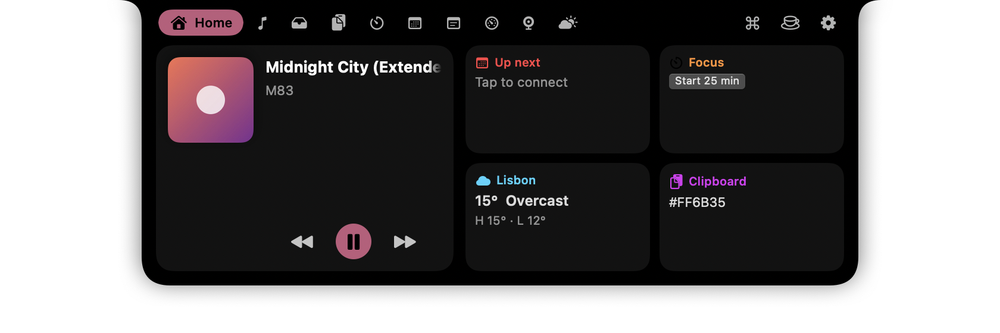

# Isla — a Dynamic Island for the Mac

Isla turns the MacBook notch into a live, hoverable island, in the spirit of
[Notchy](https://notchy.dev). It is a native SwiftUI/AppKit app with **no third-party
Swift dependencies**, built with plain `swift build` and assembled into an `.app`
by a script. macOS 14+, Apple silicon and Intel.

<p align="center"></p>

## What it does

**Collapsed pill (around the hardware notch)**
- Now Playing: album art on the left, animated bars on the right, tinted with the album colour
- HUDs: volume, brightness, Caps Lock replace the macOS overlay (optional key interception)
- Battery: plugged in / charging / low-battery islands
- Timer: progress ring and remaining time while a countdown or Pomodoro runs
- Messages from scripts: title, subtitle, icon and progress via the local API or `isla://` URLs
- Keep-awake indicator, optional clock

**Expanded panel (hover, click, or ⌃⌥N)**
| Tab | Contents |
|---|---|
| Home | music card, up-next event, focus timer, weather, latest clipboard item |
| Music | artwork, scrubber, ±15 s, prev/play/next, source app |
| Shelf | drop files on the notch, drag them out later, AirDrop / copy / reveal |
| Clipboard | searchable history with pins, colours, links, images, files; double-click pastes |
| Timer | Pomodoro with sessions-per-day, countdown presets, drift-free stopwatch |
| Calendar | today's events with Join buttons for Zoom / Meet / Teams links |
| Notes | one autosaved quick note |
| System | CPU, memory, disk, battery gauges; network rate, cycles, uptime |
| Mirror | camera check before a call (never recorded) |
| Weather | current + 5 days from Open-Meteo, city-based, no location permission |

Plus a **command palette** (⌘K inside the panel, ⌃⌥K anywhere), a **menu bar item**,
a **settings window** (⌘,), **launch at login**, and **hide from screen capture**.

## Build and run

```sh
scripts/build.sh            # release build → build/Isla.app (ad-hoc signed)
scripts/build.sh debug      # faster incremental build
scripts/build.sh release --universal   # arm64 + x86_64
open build/Isla.app
```

Requires Xcode 15+ command-line tools. No Homebrew, no CocoaPods, no Xcode project.
The first launch shows a welcome island and opens Settings.

Because the app is ad-hoc signed, macOS ties privacy grants (Accessibility, Calendar,
Camera) to the binary hash: rebuilding invalidates them and you re-grant in
System Settings. Sign with a Developer ID to avoid that.

## Keyboard

| Shortcut | Action |
|---|---|
| ⌃⌥N | toggle the panel |
| ⌥Space | hide / show Isla |
| ⌃⌥C | clipboard tab |
| ⌃⌥K | command palette |
| ⌃⌥T | timer tab |
| ⌃⌥S | shelf tab |
| inside the panel | ⌘1–9 tabs · ← → cycle · ⌘K palette · esc close |

Hotkeys use Carbon `RegisterEventHotKey`, so they work without Accessibility.

## Automation

**URL scheme** (works from Shortcuts, scripts, `open`):

```
isla://show?title=Build%20done&message=main%20·%2042s&symbol=hammer.fill&duration=4
isla://open?tab=clipboard   isla://close   isla://toggle
isla://timer?minutes=10     isla://timer?action=pomodoro
```

**Local API** (Settings → Developer → enable). Newline-delimited JSON over TCP on
`127.0.0.1:9999`, token required:

```sh
T=$(defaults read dev.joinal.isla localAPIToken)
echo "{\"token\":\"$T\",\"command\":\"status\"}" | nc 127.0.0.1 9999
echo "{\"token\":\"$T\",\"title\":\"Tests passed\",\"subtitle\":\"312 green\",\"symbol\":\"checkmark.seal.fill\"}" | nc 127.0.0.1 9999
echo "{\"token\":\"$T\",\"command\":\"music\",\"action\":\"toggle\"}" | nc 127.0.0.1 9999
echo "{\"token\":\"$T\",\"command\":\"timer\",\"action\":\"countdown\",\"minutes\":25}" | nc 127.0.0.1 9999
```

Commands: `status open close toggle hide show tab music timer keepawake clipboard shelf
volume brightness settings snapshot`. A request with a `title` and no `command` shows a
message island. `snapshot` renders the island (or `"window":"settings"`) to a PNG, which
is how the screenshots in `docs/` were taken without screen-recording permission.

A Claude Code / shell hook is one line:

```sh
# ~/.zshrc — announce long commands in the notch
preexec() { __t0=$SECONDS }
precmd() { (( SECONDS - __t0 > 30 )) && echo "{\"token\":\"$ISLA_TOKEN\",\"title\":\"Command finished\",\"subtitle\":\"$((SECONDS-__t0))s\",\"symbol\":\"terminal.fill\"}" | nc -w1 127.0.0.1 9999 >/dev/null }
```

## Permissions

Only asked when you enable the feature:

| Permission | Feature |
|---|---|
| none | pill, panel, music, HUD display, clipboard, shelf, timer, notes, system, weather, API, hotkeys |
| Accessibility | replace the system HUD (key interception), Caps Lock indicator, paste from clipboard |
| Calendars | Calendar tab, up-next card |
| Camera | Mirror tab |
| Automation (Music/Spotify) | only the AppleScript fallback when the Now Playing adapter is unavailable |

## How it works

- **Window.** One borderless, non-activating `NSPanel` at level `mainMenu + 3`, joined to
  all Spaces and fullscreen apps, centred on the notched display. The panel is large
  (panel width + padding) but fully transparent except for the island, and macOS routes
  clicks on transparent pixels to the windows beneath. `Notch/NotchWindow.swift`
- **Geometry.** `NSScreen.auxiliaryTopLeftArea/TopRightArea` and `safeAreaInsets.top`
  give the exact notch rectangle (220 × 38 pt on a 14-inch MacBook Pro). The closed
  island covers it with a 6 pt top flare and 14 pt bottom radius; open it swells to
  19 / 24 pt and the configured panel size. `Notch/NotchGeometry.swift`, `NotchShape.swift`
- **State.** `NotchViewModel` holds `closed/open`, hover with a configurable delay and a
  350 ms exit grace, a `Transient` slot for HUD/battery/message islands with auto-expiry,
  and the selected tab. The compact row renders by priority: transient › timer › music › idle.
- **Now Playing.** Since macOS 15.4 `mediaremoted` only answers Apple-signed processes.
  Isla bundles [MediaRemoteAdapter](https://github.com/ungive/mediaremote-adapter)
  (BSD-3) and runs it inside `/usr/bin/perl`, streaming JSON diffs over a pipe. Playback
  commands go the same way. If the adapter fails its self-test, Isla falls back to
  AppleScript polling of Spotify / Music. `Features/Music/MusicManager.swift`
- **HUDs.** Volume comes from CoreAudio property listeners on the default output device;
  brightness from `DisplayServicesGetBrightness` polled at 2.5 Hz. With Accessibility
  granted and "Replace the system HUD" on, a `CGEvent` tap swallows the NX media keys
  and applies the change itself, so macOS never draws its overlay.
- **Clipboard.** Polls `NSPasteboard.changeCount` twice a second, skips pasteboards
  marked concealed/transient by password managers, persists to
  `~/Library/Application Support/Isla/Clipboard`.
- **Idle cost.** ~0.1 % CPU, ~190 MB RSS with every feature on. Disabled tabs never start.

## Project layout

```
Package.swift                 SwiftPM manifest (single executable target, no deps)
Resources/Info.plist          LSUIElement app, isla:// URL scheme, usage strings
Resources/AppIcon.icns        generated by scripts (see git history)
Vendor/mediaremote-adapter/   MediaRemoteAdapter.framework + perl shim (BSD-3)
scripts/build.sh              swift build → build/Isla.app, ad-hoc codesign
scripts/snap.sh               render the island to /tmp/isla-<name>.png via the API
Sources/Isla/
  App/            IslaApp (MenuBarExtra), AppDelegate (window, monitors, URL scheme)
  Notch/          window, geometry, shape, view model, root/compact/panel/home views
  Features/       Music, HUD, Battery, Clipboard, Shelf, Timer, Calendar, Notes,
                  System, Camera, Weather, KeepAwake, Palette, API
  Settings/       settings window and panes
  Hotkeys/        Carbon global hotkeys
  Support/        Preferences (UserDefaults wrapper), extensions, haptics, logging
```

## Research notes: what Notchy does (Nov 2026)

Gathered from notchy.dev, its help centre and changelog, as the brief for this build.

- One developer (Vishva Variya), closed source, SwiftUI, macOS 13+, universal. $24.99
  one-time with a 7-day trial since v2.0.0 (Oct 26 2026); ~222 releases in six months via
  Sparkle; 134 languages; claims ~0.9 % of one core under load.
- Collapsed pill: Now Playing with artwork + spectrum, system HUDs, call/message islands,
  battery, timers, download progress, agent (Claude Code / Codex) approvals, caps lock,
  keystroke HUD, multiple live activities, Lottie idle animations.
- Panel: Home cards, Now Playing with synced lyrics (LRCLIB), clipboard with smart actions,
  file shelf with AirDrop, Pomodoro, calendar/reminders, notes, stocks, weather, system
  stats, terminal (VT100), command palette ⌃⌥K / ⌘1-9, launcher wheel ⌃⌥L.
- Platform tricks: per-app volume via CoreAudio process taps (14.4+), DDC for external
  monitors via IOAVService, Face Unlock with Apple Vision + Keychain-stored password typed
  through Accessibility, window snapping, menu bar icon hiding, lock-screen widgets,
  notification mirroring (Full Disk Access), knock detection via accelerometer.
- Developer surface: local API on 127.0.0.1:9999, newline JSON with a per-install token;
  `notchy://show?title=&message=` URL scheme; zsh preexec hook; Claude Code hooks.
- Defaults: hover opens the panel; ⌥Space hides; ⌃⌥N opens; accessibility is the only
  mandatory permission; everything else prompts when the feature is enabled.

Isla implements the core of that list. Not implemented (by choice, for an overnight build):
lyrics, per-app volume, DDC, Face Unlock, window snapping, notification mirroring,
terminal, stocks, Sparkle updates, localisation.

## Acknowledgements

- [MediaRemoteAdapter](https://github.com/ungive/mediaremote-adapter) — Jonas van den Berg, BSD-3-Clause
- Notch shape adapted from [DynamicNotchKit](https://github.com/MrKai77/DynamicNotchKit) — Kai Azim, MIT
- Window technique informed by [boring.notch](https://github.com/TheBoredTeam/boring.notch) (GPL-3; no code copied)
- Weather by [Open-Meteo](https://open-meteo.com) (CC BY 4.0)

Isla is not affiliated with Apple or with Notchy.
