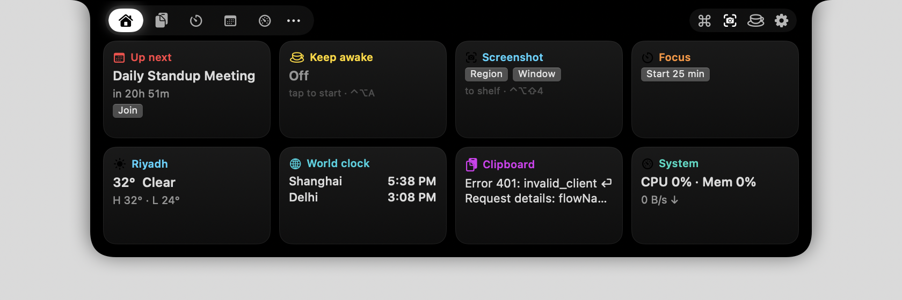
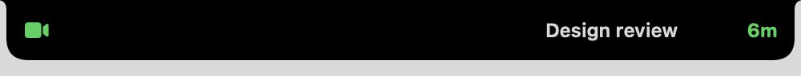
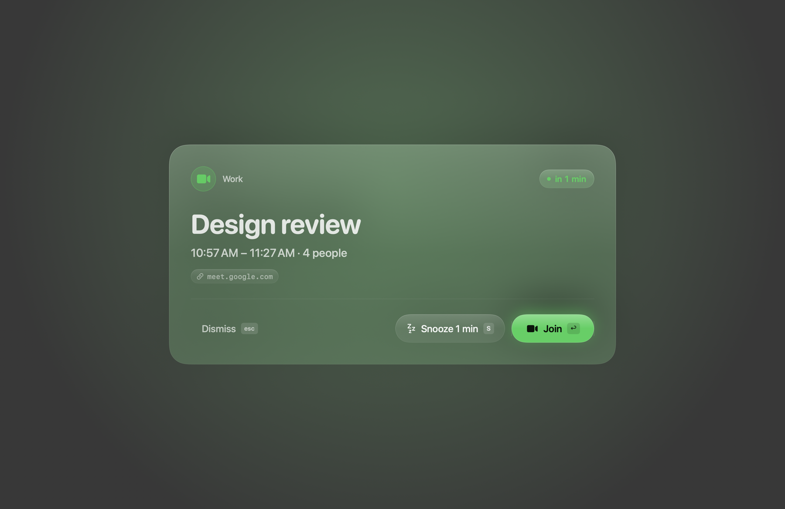
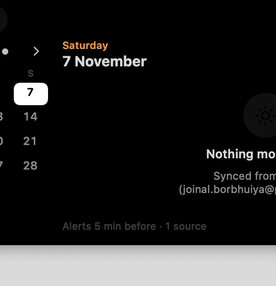
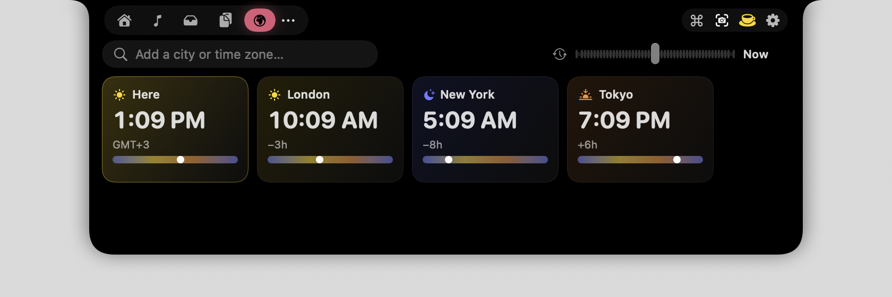
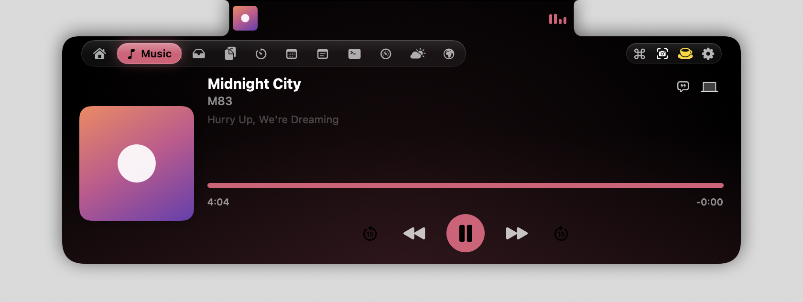
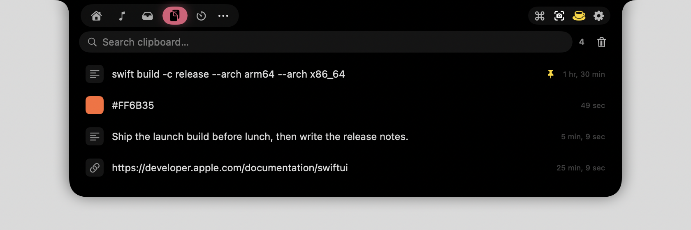
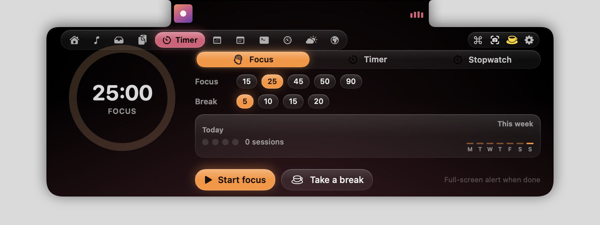
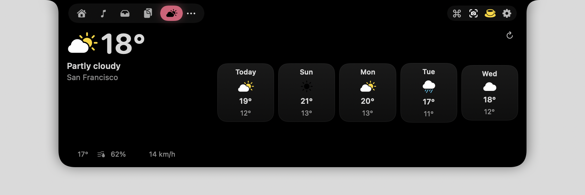
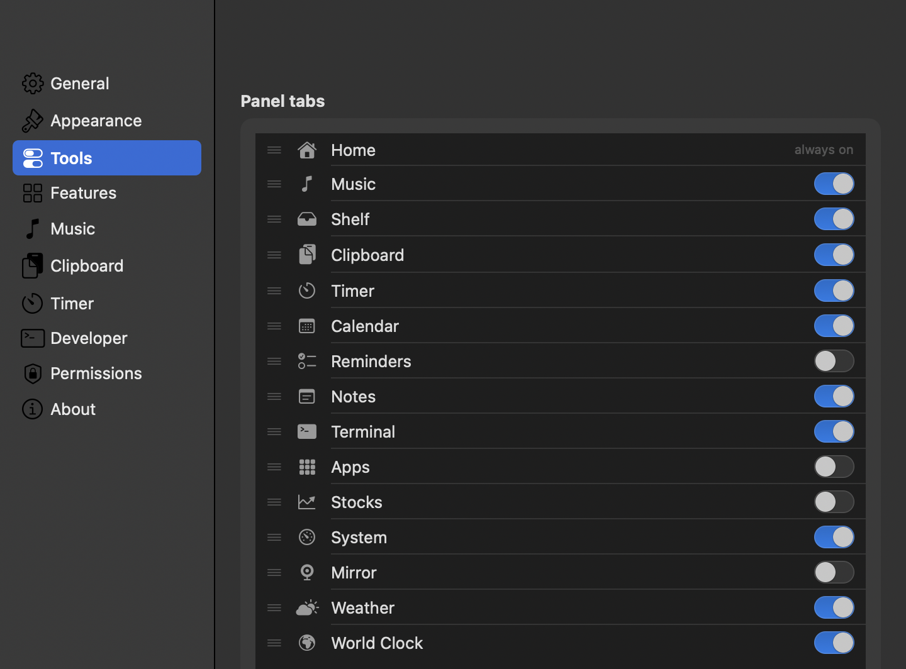

<p align="center">
  
</p>

<h1 align="center">Loft</h1>

<p align="center">
  <b>A Dynamic Island for the Mac.</b><br>
  The space around your MacBook's notch becomes a live, hoverable island for the things you reach for all day:
  what's playing, your next meeting, a file shelf, timers, clipboard, a terminal, and the tools you'd otherwise keep in the menu bar.
</p>

<p align="center">
  <a href="https://github.com/joinalahmed/loft/releases/latest"></a>
  
  
  
</p>

Native SwiftUI + AppKit, **no third-party Swift dependencies**, no analytics, no accounts.
Everything runs on your Mac; the only network calls are the services you turn on (weather, lyrics, stocks, and a Google
Calendar you choose to connect).

---

## Install

1. **[Download the latest Loft DMG](https://github.com/joinalahmed/loft/releases/latest)** (universal, about 4 MB; a zip and SHA-256 checksums are attached to every release) and drag Loft to Applications.
2. Loft is signed ad hoc, not notarised, so the first launch needs one extra step: **right-click Loft.app → Open → Open**,
   or from a terminal:
   ```sh
   xattr -dr com.apple.quarantine /Applications/Loft.app
   ```
3. Hover the notch. The panel hangs down from it, below the menu bar, so your menu bar icons stay visible and clickable
   while it is open. Press `⌃⌥N` any time to open it from the keyboard, and `⌘,` for Settings.

Loft asks for a permission only when you enable the feature that needs it (see [Permissions](#permissions)).

## What it does

### Around the notch, while you work

<p align="center"></p>

- **Now Playing** from Music, Spotify or any app: artwork on the left, live bars on the right, tinted with the album colour.
- **HUDs** for volume, brightness and Caps Lock that replace the macOS overlay.
- **Meetings**: a countdown and Join glyph from ten minutes before an event. At your lead time a full-screen alert on every display: **↩ Join · S snooze · esc dismiss**.
- **Live activities**: timer ring, screenshot thumbnails, download progress, battery states, keep-awake, privacy dots while the mic or camera is on, a call island with one-tap mute.
- **Messages and approvals from your scripts** via the local API or `loft://` URLs. A Claude Code hook turns permission prompts into Allow / Deny buttons in the notch.

<p align="center"></p>

### Inside the island

Hover, click, or press `⌃⌥N`. Tabs can be switched on, off and reordered in **Settings → Tools**; the Home tab adapts its grid to whatever you keep.

| Tab | What you get |
|---|---|
| **Home** | adaptive cards: up next (with Join), keep awake, screenshots, focus timer, weather, world clock, clipboard, system, reminders, lock |
| **Music** | artwork, scrubber, ±15 s, transport, source app, time-synced lyrics, audio-output switcher |
| **Shelf** | drop files on the notch and drag them out later; AirDrop, copy, reveal; convert / resize / OCR images; zip anything |
| **Clipboard** | searchable history with pins: text, links, colours, images, files; double-click pastes |
| **Timer** | Focus sessions with break and duration chips, countdown presets, +1 min while running, drift-free stopwatch, daily and weekly history |
| **Calendar** | month grid with event dots, day agenda, Join buttons; every macOS account plus a directly connected Google account |
| **Reminders** | overdue / today / later across lists; check off, add with a due date; full-screen alert when due |
| **Notes** | one autosaved quick note |
| **Terminal** | a real zsh session in the notch (`` ⌃⌥` ``) with your own dotfiles |
| **World Clock** | cities side by side with day/night tint and a time scrubber; search by city or country ("Delhi", "China", "Bombay") |
| **Apps** | switch, hide or quit running apps; type-to-launch grid |
| **Stocks** | tickers of your choice with day sparklines |
| **System** | CPU, memory, disk, battery, network rate, Wi-Fi details, external drives with Eject |
| **Mirror** | camera check before a call, never recorded |
| **Weather** | current conditions and five days, by city, no location permission |

<p align="center">
  
  
</p>
<p align="center">
  
  
</p>
<p align="center">
  
  
</p>

### Daily drivers, built out in depth

- **Calendar sync.** Anything in System Settings → Internet Accounts shows up and refreshes on every change. Google Calendar can also be connected directly with your own OAuth desktop client (PKCE and loopback sign-in, read-only scope, refresh token in the Keychain). Duplicates between the two sources are dropped.
- **Meeting alerts.** Zoom, Meet, Teams, Webex, Whereby, FaceTime, Slack and Discord links are detected. Declined events are skipped. The same alert style fires for finished timers and due reminders.
- **Screenshots.** Region, window or full screen through the system capture UI (`⌃⌥⇧3/4/5`), copied, saved, shelved with a thumbnail. Native `⌘⇧3/4/5` captures are shelved too. Plus a screen colour picker (`⌃⌥P`) and copy-text-from-screen OCR (`⌃⌥O`).
- **Keep awake.** Toggle, or pick 15 min to 4 h, from the header, Home, menu bar, palette or `⌃⌥A`.
- **Lock screen.** Lock from the header, menu, palette or `⌃⌥Q`; pause music and release keep-awake on lock; resume and a welcome-back island on unlock; experimental widgets over the lock screen.
- **Command palette.** `⌘K` inside the island or `⌃⌥K` anywhere: every tool and tab, arithmetic, URLs, web search.

<p align="center"></p>

## Keyboard

| Shortcut | Action |
|---|---|
| `⌃⌥N` | toggle the island |
| `⌥Space` | hide / show Loft |
| `⌃⌥K` | command palette |
| `⌃⌥C` `⌃⌥T` `⌃⌥S` `⌃⌥L` `` ⌃⌥` `` | clipboard · timer · shelf · apps · terminal |
| `⌃⌥A` | toggle keep awake |
| `⌃⌥M` | join the next meeting |
| `⌃⌥⇧M` | mute / unmute the microphone |
| `⌃⌥P` `⌃⌥O` | pick a colour · copy text from screen |
| `⌃⌥⇧3 / 4 / 5` | screenshot: full screen · region · window |
| `⌃⌥Q` | lock the screen |
| inside the island | `⌘1–9` tabs · `← →` cycle · `⌘K` palette · `esc` close |

Every shortcut can be switched off in Settings → Tools. Hotkeys use Carbon `RegisterEventHotKey`, so they work without Accessibility.

## Automation

**URL scheme**, from Shortcuts, scripts or `open`:

```
loft://show?title=Build%20done&message=main%20·%2042s&symbol=hammer.fill&duration=4
loft://open?tab=clipboard   loft://close   loft://toggle   loft://lock
loft://timer?minutes=10     loft://timer?action=pomodoro
```

**Local API** (Settings → Developer → Enable local API). Newline-delimited JSON over TCP on `127.0.0.1:9191` with a per-install token:

```sh
T=$(defaults read dev.joinal.loft localAPIToken)
echo "{\"token\":\"$T\",\"command\":\"status\"}" | nc 127.0.0.1 9191
echo "{\"token\":\"$T\",\"title\":\"Tests passed\",\"subtitle\":\"312 green\",\"symbol\":\"checkmark.seal.fill\"}" | nc 127.0.0.1 9191
echo "{\"token\":\"$T\",\"command\":\"timer\",\"action\":\"countdown\",\"minutes\":25}" | nc 127.0.0.1 9191
echo "{\"token\":\"$T\",\"command\":\"worldclock\",\"add\":\"Tokyo\"}" | nc 127.0.0.1 9191
```

Commands: `status open close toggle hide show tab music timer keepawake screenshot meeting clipboard shelf volume brightness
settings snapshot ask mic audio colorpicker ocr eject reminders privacy lyrics calc worldclock lock activities demo debug`.
`activities` lists what Loft is doing right now (timer, imminent meeting, keep-awake, playback) as structured records.
A request with a `title` and no `command` shows a message island. `ask` blocks until the user taps a button in the pill and replies
`{"answer":"Allow","approved":true}`. `snapshot` renders the island or a window to a PNG and `demo` fills the island with sample data; every screenshot in this
README was taken that way, so none of them shows real data.

**Claude Code hooks** live in `scripts/claude-code/`: `loft-notify.sh` shows Stop and Notification events as islands,
`loft-approve.sh` turns `PermissionRequest` into an Allow / Deny prompt in the notch. Add them to `~/.claude/settings.json`:

```json
"hooks": {
  "Stop":              [{ "hooks": [{ "type": "command", "command": "/path/to/loft/scripts/claude-code/loft-notify.sh" }] }],
  "Notification":      [{ "hooks": [{ "type": "command", "command": "/path/to/loft/scripts/claude-code/loft-notify.sh" }] }],
  "PermissionRequest": [{ "hooks": [{ "type": "command", "command": "/path/to/loft/scripts/claude-code/loft-approve.sh", "timeout": 130 }] }]
}
```

## Permissions

Asked only when you enable the feature:

| Permission | Feature |
|---|---|
| none | island, music, HUD display, clipboard, shelf, timer, notes, terminal, world clock, system, weather, API, hotkeys |
| Accessibility | replace the system HUD, Caps Lock indicator, paste from clipboard history |
| Calendars / Reminders | Calendar and Reminders tabs, up-next card, meeting alerts |
| Camera | Mirror tab |
| Screen Recording | screenshots, colour picker and OCR taken from the notch |
| Automation (Music / Spotify) | only the AppleScript fallback when the Now Playing adapter is unavailable |

## Build from source

```sh
git clone https://github.com/joinalahmed/loft.git && cd loft
scripts/build.sh                      # release build → build/Loft.app (ad-hoc signed)
scripts/build.sh debug                # faster incremental build
scripts/build.sh release --universal  # arm64 + x86_64
scripts/release.sh 1.2.3              # universal app + zip + DMG + checksums in dist/
open build/Loft.app
```

Xcode 15+ command-line tools are all you need: no Homebrew, no CocoaPods, no Xcode project.
Because the app is ad-hoc signed, macOS ties privacy grants to the binary: rebuilding means re-granting Accessibility,
Calendar and Camera. Sign with your own Developer ID to avoid that.

## How it works

- **Window.** One borderless, non-activating `NSPanel` above the menu bar, on every Space and over full-screen apps, centred on the notched display. Mouse events are accepted only inside the island's own shape, so clicks and keystrokes everywhere else, including the menu bar beside the open panel, reach what is underneath.
- **Geometry.** `NSScreen.auxiliaryTopLeftArea` / `TopRightArea` and `safeAreaInsets.top` give the exact notch rectangle. The closed pill lays its two sides out symmetrically around the notch so nothing is ever drawn under it; the open panel keeps a notch-sized head in the menu bar row and widens below it.
- **Look.** Every surface is drawn as frosted glass with explicit fills and hairlines, and on macOS 26+ the system's Liquid Glass material is layered underneath for live lensing. One button style covers the island: glass, tinted prominent, and quiet.
- **Now Playing.** Since macOS 15.4 `mediaremoted` answers only Apple-signed processes, so Loft bundles [MediaRemoteAdapter](https://github.com/ungive/mediaremote-adapter) and runs it inside `/usr/bin/perl`, streaming JSON diffs over a pipe. If that fails, it polls Spotify and Music over AppleScript.
- **HUDs.** CoreAudio listeners for volume, `DisplayServices` for brightness. With Accessibility granted a `CGEvent` tap swallows the media keys and applies the change itself, so macOS never draws its overlay.
- **Alerts.** One controller shows a full-bleed takeover panel per display, scaled to the screen, with keyboard shortcuts for every action.
- **Idle cost.** About 0.1 % CPU with every feature on. Disabled tabs never start their services.

```
Package.swift                 SwiftPM manifest, single executable target, no dependencies
Resources/                    Info.plist (LSUIElement, loft:// scheme, usage strings), app icon
Vendor/mediaremote-adapter/   MediaRemoteAdapter.framework + perl shim (BSD-3-Clause)
scripts/                      build.sh, release.sh, snap.sh, claude-code hooks
Sources/Loft/
  App/        menu bar app, AppDelegate (window, monitors, URL scheme)
  Notch/      window, geometry, shape, view model, compact row, panel, home grid
  Features/   one folder per tool: Music, Calendar, Shelf, Clipboard, Timer, Terminal,
              WorldClock, Lock, Alerts, Screenshot, Reminders, System, Weather, API, …
  Settings/   settings window and panes, Tools pane
  Hotkeys/    Carbon global hotkeys
  Support/    preferences, Keychain, extensions, logging
```

## Roadmap

- Live Activities: the activity records already exist (`activities` in the API); they become ActivityKit Live Activities as soon as the macOS SDK stops marking ActivityKit unavailable on macOS (build with `-D LOFT_ACTIVITYKIT`)
- Bluetooth and AirPods connect island with battery levels
- AI coding agents: Allow / Deny sessions and usage quotas in the pill for Claude Code, Codex and friends
- Notification mirroring with inline reply
- Notarised builds and a Homebrew cask
- Per-app volume, local dictation, teleprompter, localisation

Issues and pull requests are welcome.

## Acknowledgements

- [MediaRemoteAdapter](https://github.com/ungive/mediaremote-adapter) by Jonas van den Berg, BSD-3-Clause
- Notch shape adapted from [DynamicNotchKit](https://github.com/MrKai77/DynamicNotchKit) by Kai Azim, MIT
- Window technique informed by [boring.notch](https://github.com/TheBoredTeam/boring.notch), GPL-3, no code copied
- Weather by [Open-Meteo](https://open-meteo.com), CC BY 4.0; lyrics by [LRCLIB](https://lrclib.net)
- Loft is not affiliated with Apple.

MIT licence. Copyright © 2026 Joinal Ahmed.
